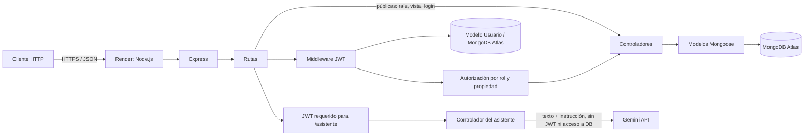
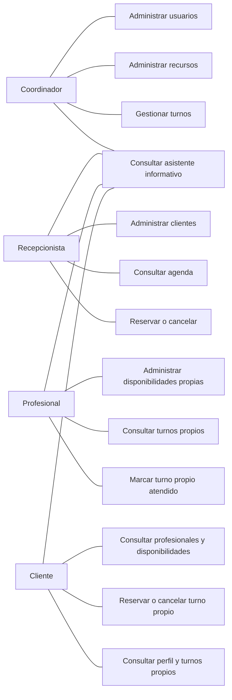
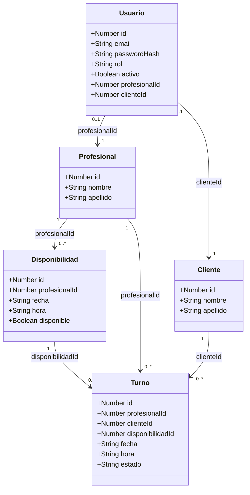
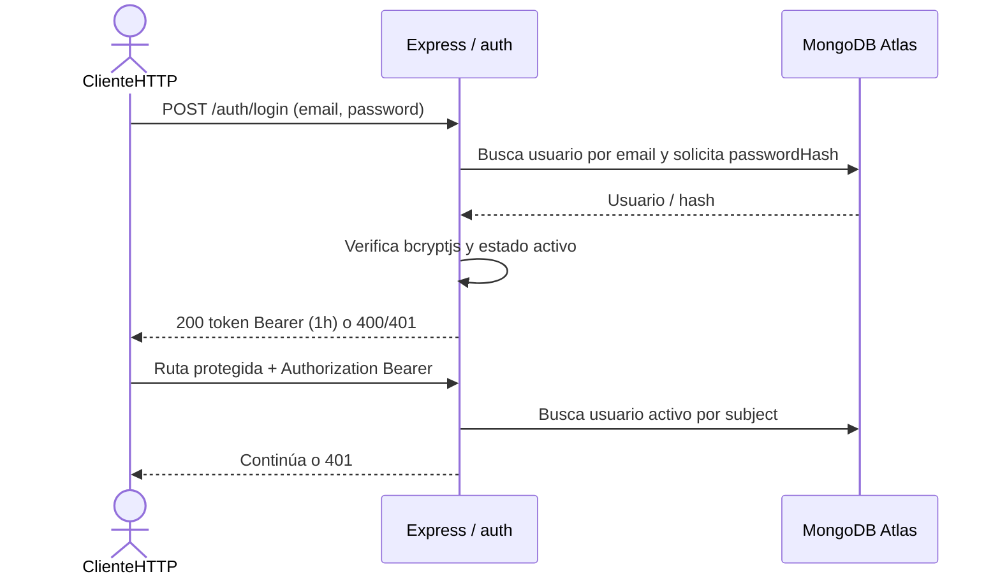
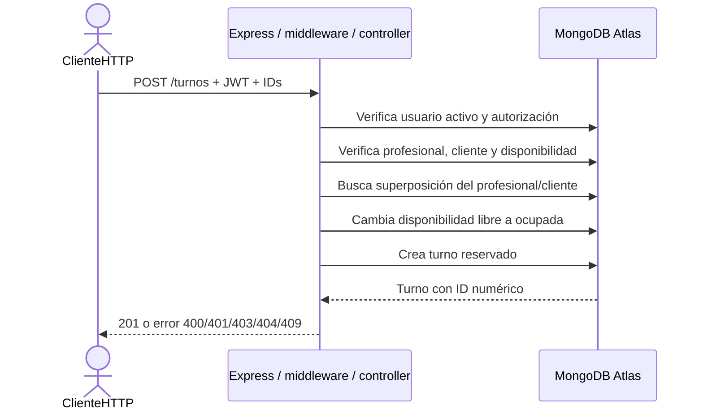
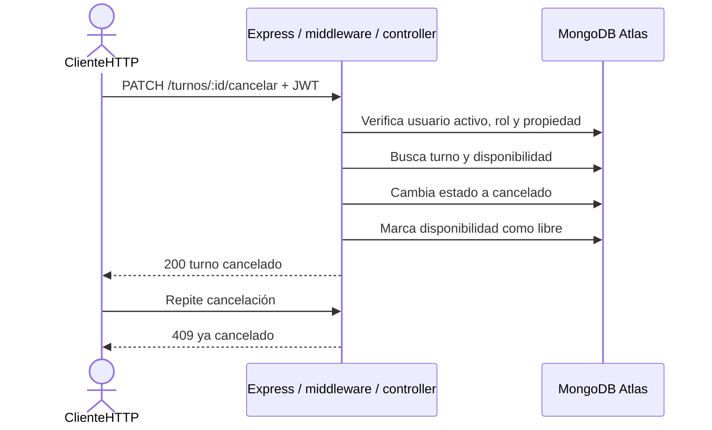
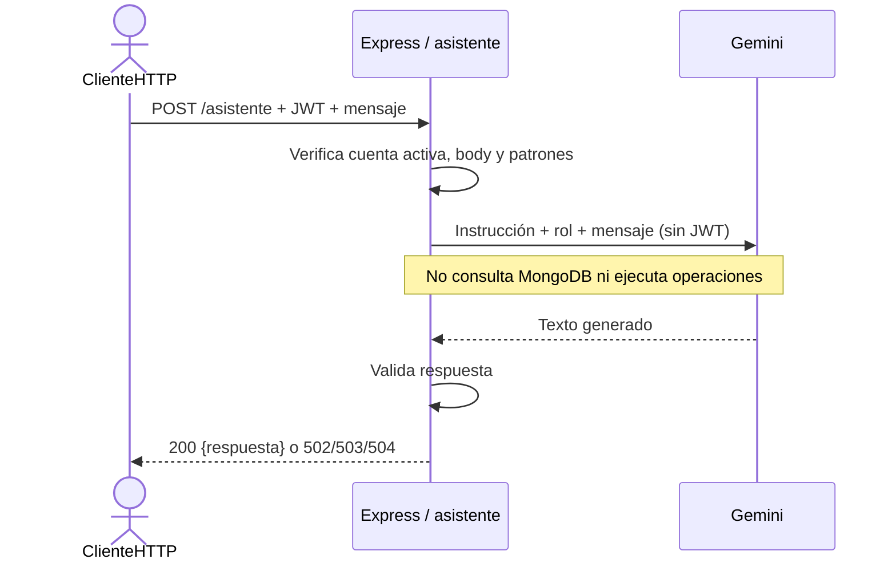
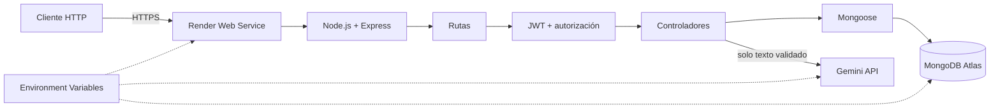

# TurnoFlex — Documentación técnica final

**Estado de este documento:** borrador de documentación de la tercera entrega para revisión del equipo. Las responsabilidades de integrantes y la reflexión se presentan como propuestas/borradores, no como acuerdos aprobados.

## Índice

1. Evolución y tecnologías por entrega
2. Arquitectura actual
3. Usuarios, roles y autorización
4. Autenticación y seguridad
5. Asistente IA
6. API y reglas funcionales
7. Requerimientos funcionales y no funcionales
8. Integración con Ingeniería de Software
9. Diagramas
10. Pruebas y evidencias
11. Problemas encontrados y soluciones
12. Uso de IA durante el desarrollo
13. Tecnologías no utilizadas
14. Equipo: propuesta de distribución
15. Reflexión final: borrador
16. Bibliografía y fuentes técnicas

## 1. Evolución y tecnologías por entrega

TurnoFlex fue evolucionando por incrementos. Las entregas anteriores aportan contexto histórico; la API vigente, roles y configuración se describen en [DOCUMENTACION_API.md](../DOCUMENTACION_API.md).

| Área | Primera entrega | Segunda entrega | Tercera entrega |
|---|---|---|---|
| Plataforma/API | Node.js, Express y API REST | Node.js y Express, conservando REST | Node.js y Express desplegados como servicio web |
| Persistencia | Archivo JSON (`src/data/db.json`) | MongoDB local mediante Mongoose y `async/await` | MongoDB Atlas mediante Mongoose |
| Recursos | Profesionales, clientes, disponibilidades y turnos | Se mantienen los recursos y sus reglas | Se mantienen; IDs numéricos en el contrato externo |
| Organización | Estructura inicial | Arquitectura modular con rutas, controladores, modelos, middlewares y manejo centralizado de errores | Se extiende la misma organización con autenticación, permisos y asistencia |
| Seguridad | Validaciones y reglas de negocio | Variables de entorno y validaciones de persistencia | Usuarios, JWT, roles, bcryptjs, restricciones de propiedad y secretos en entorno |
| Presentación/servicios externos | — | Vista Pug existente | Render para hosting y Gemini API para el asistente informativo |

`src/data/db.json` se conserva como respaldo temporal de la primera persistencia; la aplicación actual no lo importa automáticamente.

## 2. Arquitectura actual

### Componentes y flujo

1. Un cliente HTTP envía una solicitud JSON al servicio Express.
2. Las rutas públicas atienden el estado raíz, la vista y el login. Las demás rutas de negocio pasan por el middleware JWT.
3. El middleware verifica firma y expiración y consulta que el usuario exista y siga activo. Después, autorización aplica roles y propiedad.
4. Los controladores validan la entrada y aplican reglas de negocio mediante modelos Mongoose.
5. Mongoose persiste los recursos en MongoDB Atlas. Los IDs numéricos se mantienen como identificadores de API; `_id` no forma parte del contrato.
6. `POST /asistente` deriva el texto a Gemini mediante el controlador de asistencia. El asistente no importa modelos, no consulta Atlas ni recibe el JWT.
7. Render ejecuta el backend y entrega el puerto mediante `process.env.PORT`.



### Organización modular

- `src/routes/`: mapea métodos y paths a middleware/controladores.
- `src/controllers/`: validaciones HTTP, reglas y respuestas.
- `src/models/`: esquemas Mongoose de `Profesional`, `Cliente`, `Disponibilidad`, `Turno` y `Usuario`.
- `src/middlewares/`: autenticación, autorización/propiedad y registro de solicitudes.
- `src/config/`: conexión a MongoDB.
- `src/utils/`: utilidades JWT y bcryptjs.

## 3. Usuarios, roles y autorización

La API implementa cuatro roles. La tabla resume el alcance real de las rutas; los permisos concretos por método están en [DOCUMENTACION_API.md](../DOCUMENTACION_API.md).

| Rol | Consulta | Crea/modifica | Límites de propiedad |
|---|---|---|---|
| Coordinador | Todos los recursos, turnos y usuarios | CRUD global de profesionales, clientes y disponibilidades; crear/cancelar/atender turnos; crear usuarios y activar/desactivar | Alcance global |
| Recepcionista | Profesionales, disponibilidades, clientes y turnos | CRUD de clientes; crear/cancelar turnos | No administra usuarios/profesionales ni marca turnos como atendidos |
| Profesional | Su perfil, disponibilidades y turnos propios; también consulta disponibilidades según endpoint | CRUD de sus disponibilidades; marca como atendidos sus turnos propios | No consulta ni modifica recursos de otro profesional; no administra clientes |
| Cliente | Profesionales, disponibilidades, su perfil y turnos propios | Reserva y cancela turnos propios | No puede operar o consultar información de otro cliente |

- **401 Unauthorized:** falta un JWT válido, expiró o el usuario está inactivo/no existe.
- **403 Forbidden:** autenticación válida, pero el rol no está autorizado o intenta acceder a un recurso ajeno.
- El asistente informativo acepta a cualquiera de los cuatro roles autenticados.

## 4. Autenticación y seguridad

- `POST /auth/login` compara contraseña y hash y emite JWT Bearer con expiración de **1 hora**. El token incluye el ID numérico del usuario como subject; los roles se consultan desde la cuenta en cada solicitud.
- El middleware verifica JWT y carga solo usuarios activos. Desactivar un usuario invalida de inmediato el acceso con sus tokens existentes, sin esperar la expiración.
- bcryptjs deriva hashes con 12 salt rounds. `passwordHash` está excluido por defecto de consultas y se elimina de la serialización. Login no devuelve contraseña ni hash; `/auth/me` devuelve solo `id`, `email` y `rol`.
- `JWT_SECRET` se exige al iniciar y debe tener al menos 32 bytes UTF-8. La conexión se configura con `MONGODB_URI`; `GEMINI_API_KEY` habilita el servicio externo. `.env` es local e ignorado por Git; no se versionan valores de producción.
- En Render, las variables se cargan en **Environment Variables**: `MONGODB_URI`, `JWT_SECRET` y `GEMINI_API_KEY`. Render proporciona `PORT`; en desarrollo local puede usarse `PORT=3000`.
- Atlas controla la persistencia remota. La API mantiene las validaciones de roles/propiedad antes de consultar o modificar recursos.
- El middleware de logging registra método y URL solicitada (`originalUrl`), pero no cuerpo ni header de autorización. Como la URL puede incluir query strings, no se deben colocar secretos en parámetros de URL.
- Los errores internos se transforman en respuestas genéricas `500`. No se deben imprimir tokens, contraseñas, claves, secretos o URIs completas en logs.

## 5. Asistente IA

`POST /asistente` es un endpoint autenticado disponible para coordinador, recepcionista, profesional y cliente.

```json
{
  "mensaje": "¿Cómo reservo un turno?"
}
```

La respuesta tiene forma `{"respuesta":"..."}`. El asistente usa Gemini (`gemini-3.5-flash-lite`) y su finalidad es exclusivamente orientar sobre el uso de TurnoFlex:

- No reserva, cancela, crea usuarios o disponibilidades ni modifica datos.
- No tiene acceso directo a MongoDB ni importa modelos.
- No se envía el JWT a Gemini; se envía el mensaje y una instrucción del sistema que indica el rol autenticado.
- Rechaza body distinto de un objeto con único campo `mensaje`, mensajes vacíos o mayores de 1000 caracteres, patrones de credenciales y patrones explícitos de evasión de reglas.
- Revisa la respuesta externa para rechazar contenido vacío o patrones de credenciales. Estos filtros son validaciones de entrada/salida; no se consideran una garantía general frente a todo contenido generado.
- La solicitud al proveedor tiene timeout de 15 segundos y limita la salida a 400 tokens.
- `400`: entrada inválida, credenciales o intento detectado de evasión; `502`: falla del proveedor o respuesta inválida; `503`: clave no configurada o cuota/rate limit; `504`: timeout.
- Requiere `GEMINI_API_KEY` en el entorno. La clave no debe estar en Git ni en el body de la API.

Respuestas informativas esperables:

- “Para reservar, consulta las disponibilidades libres y elige una asociada al profesional y horario deseados. La API confirma la reserva si sigue disponible.”
- “Puedo explicarte cómo cancelar, pero no puedo ejecutar una cancelación. Usa la opción de cancelación disponible en TurnoFlex; la API comprobará los permisos.”

## 6. API y reglas funcionales

La lista completa de métodos, paths, roles, parámetros, cuerpos y códigos está en [DOCUMENTACION_API.md](../DOCUMENTACION_API.md). La raíz `GET /`, la vista `GET /vista` y el login son públicos; el resto requiere JWT.

Reglas centrales conservadas:

1. La disponibilidad debe existir y pertenecer al profesional indicado.
2. No se duplican disponibilidades para el mismo profesional, fecha y hora.
3. Solo se reserva una disponibilidad libre.
4. No se permiten reservas superpuestas para el profesional ni para el cliente.
5. Al confirmar una reserva, `disponible` pasa a `false`.
6. Cancelar cambia el turno a `cancelado` y restaura `disponible` a `true`.
7. El turno cancelado permanece en la base; una segunda cancelación responde `409 Conflict`.
8. La actualización general de turno solo permite transicionar de `reservado` a `atendido`.

## 7. Requerimientos

### Requerimientos funcionales

| ID | Requerimiento |
|---|---|
| RF01 | Consultar, crear, modificar y eliminar profesionales según el rol. |
| RF02 | Consultar, crear, modificar y eliminar clientes según el rol y la propiedad. |
| RF03 | Consultar y administrar disponibilidades, comprobando existencia del profesional y evitando duplicados. |
| RF04 | Reservar una disponibilidad libre y validar profesional, cliente, disponibilidad y conflictos de horario. |
| RF05 | Cancelar turnos sin borrar su registro, liberar disponibilidad y rechazar cancelación repetida. |
| RF06 | Consultar turnos con filtros y restringir resultados por el rol/propiedad del usuario. |
| RF07 | Autenticar usuarios mediante email y contraseña y emitir JWT con vencimiento. |
| RF08 | Permitir al coordinador crear usuarios y activar/desactivar cuentas según las reglas implementadas. |
| RF09 | Autorizar acciones por rol y limitar acceso de profesional/cliente a sus recursos asociados. |
| RF10 | Permitir a usuarios autenticados consultar su sesión sin devolver información de contraseña. |
| RF11 | Brindar orientación informativa con IA, sin ejecutar operaciones ni modificar datos. |

### Requerimientos no funcionales

| ID | Requerimiento | Implementación / límite |
|---|---|---|
| RNF01 | Seguridad de acceso | JWT Bearer, verificación de cuenta activa, autorización por rol y propiedad. |
| RNF02 | Protección de credenciales | bcryptjs para contraseñas; hash no expuesto; secretos configurados por entorno. |
| RNF03 | Persistencia | MongoDB mediante Mongoose; Atlas en producción. No se afirma una métrica de disponibilidad medida. |
| RNF04 | Mantenibilidad | Separación por rutas, controladores, modelos, middlewares y utilidades. |
| RNF05 | Configurabilidad | URI, secreto JWT, clave Gemini y puerto obtenidos del entorno. |
| RNF06 | Manejo de errores | Códigos HTTP explícitos para validación, permisos y reglas; error interno genérico. |
| RNF07 | Despliegue | Servicio Node.js en Render con variables de entorno y puerto provisto por hosting. |
| RNF08 | Integración externa acotada | Asistente con tamaño máximo de entrada, salida limitada y timeout; la disponibilidad del proveedor no se garantiza. |
| RNF09 | Trazabilidad operativa | Se registra método y URL de solicitud; no se reportan métricas, SLA ni auditoría completa. No incluir secretos en URL/query. |
| RNF10 | Escalabilidad operativa | API REST stateless respecto de sesión; no se midieron cargas ni se afirma capacidad numérica. |

## 8. Integración con Ingeniería de Software

TurnoFlex parte de un modelo de dominio con cuatro actores: coordinador, recepcionista, profesional y cliente. Ese modelo conceptual se llevó a las reglas de autorización y a las responsabilidades técnicas:

- El coordinador administra globalmente el sistema.
- La recepcionista gestiona las tareas operativas de clientes y turnos.
- El profesional mantiene su agenda y atiende sus propios turnos.
- El cliente consulta opciones y administra sus propias reservas.

La separación de roles reduce la concentración de responsabilidades y hace explícitos los casos de uso permitidos. Las restricciones de propiedad traducen al middleware los vínculos del modelo entre un usuario profesional/cliente y su recurso asociado. Los controladores mantienen las reglas de negocio (por ejemplo, disponibilidad libre y transición de estado), mientras que rutas y middlewares aplican autenticación y permisos antes de invocarlas.

## 9. Diagramas

### Casos de uso



### Modelos de dominio



Las relaciones se representan con IDs numéricos en los esquemas; el diagrama no implica que se usen referencias ObjectId de Mongoose.

### Secuencia de login JWT



### Secuencia de reserva



### Secuencia de cancelación



### Secuencia del asistente



### Arquitectura y despliegue



## 10. Pruebas y evidencias

Los resultados históricos se separan por entorno. “Confirmado por el equipo” identifica validaciones de entregas previas comunicadas como realizadas; esta etapa documental no volvió a ejecutar llamadas de producción ni a alterar datos.

| Entorno | Caso | Resultado documentado |
|---|---|---|
| Local | Inicio de servidor con configuración local y conexión a base de datos | Verificado en etapas de desarrollo; para Windows se usó `npm.cmd` cuando PowerShell bloqueaba `npm.ps1`. |
| Local | Login `200`, ruta protegida sin token `401`, rol insuficiente `403` | Validados en las pruebas de autenticación previas. |
| Local | `/auth/me` y respuestas de usuario sin `passwordHash` | Validado en pruebas previas. |
| Local | Reserva `201`, cancelación `200`, segunda cancelación `409` y disponibilidad restaurada | Reglas probadas en las etapas de turnos; repetir con un conjunto demo antes de una nueva presentación. |
| MongoDB Atlas | Conexión del backend y persistencia de recursos | Conexión y persistencia confirmadas durante la preparación de Atlas/Render. |
| Render | `GET /` devuelve `200` | Etapa 4 cerrada por el equipo; servicio online en `https://turnoflex-kygy.onrender.com`. |
| Render | Ruta de negocio sin JWT `401`; login `200`; `/auth/me` `200`; rol incorrecto `403` | Validado al cerrar la Etapa 4, según confirmación del equipo. |
| Render | `/auth/me` y respuestas de usuario sin `passwordHash` | Validación de respuestas de usuario reportada al cerrar la Etapa 4. |
| Render / Atlas | Consulta de profesionales y disponibilidades, reserva `201` y cancelación `200` | Etapa 4 cerrada por el equipo; Atlas fue la persistencia del servicio desplegado. |
| Render / Atlas | Segunda cancelación `409`, disponibilidad vuelve a `true` y los cambios persisten | Validado como parte del cierre de la Etapa 4, según confirmación del equipo. |
| Render | `/asistente` sin JWT devuelve `401` | Etapa 5 declarada validada en producción por el equipo. |
| Render / Gemini | Pregunta de reserva responde `200` en español; solicitud de cancelación aclara que no ejecuta acciones | Etapa 5 declarada validada en producción por el equipo. |
| Render | Mensaje vacío, mayor a 1000 caracteres o con patrón de credencial devuelve `400` | Validaciones de entrada reportadas al cerrar la Etapa 5. |
| Render / Gemini | No se exponen API key, JWT, contraseñas, `JWT_SECRET` ni `MONGODB_URI`; el asistente no modifica Atlas | Validación de seguridad y de no ejecución reportada al cerrar la Etapa 5. |
| Render | No se detectaron secretos en los logs revisados | Revisión reportada al cerrar la Etapa 5. El middleware no registra cuerpos ni headers, pero sí la URL completa; por eso no deben enviarse secretos en query strings. |
| Render / Gemini | Llamadas iniciales `503` y validación posterior `200` | La indisponibilidad/cuota del proveedor se comunicó temporalmente; el equipo confirmó posteriormente respuestas reales `200`. |
| Todas | Framework de tests automatizados | No se incorporó un framework de testing como parte de la consigna. |

Para la demostración, usar cuentas y datos ficticios claramente identificados, sin documentar credenciales, JWT ni datos personales de producción. Comprobar persistencia en Atlas consultando la colección correspondiente y no guardar una contraseña en la evidencia.

## 11. Problemas encontrados y soluciones

| Problema | Resolución aplicada |
|---|---|
| PowerShell bloqueaba `npm.ps1` al ejecutar npm | En Windows se utilizó `npm.cmd` para instalar/iniciar sin cambiar la política global del sistema. |
| Node.js local `v26.8.2` estaba fuera del rango declarado por el proyecto | Para las verificaciones y despliegues, usar una versión compatible con `>=22.0.0 <25`; aunque el proceso local llegó a iniciar, npm señaló la incompatibilidad de engine. |
| `.env` debía separar configuración de código | Se documentaron variables de entorno y se mantuvo `.env` ignorado; `.env.example` usa placeholders, nunca secretos. |
| Conexión local/remota a Atlas no establecida inicialmente | Se revisó la URI de conexión, la configuración de Network Access de Atlas para el origen del servicio y la autenticación del usuario de base de datos. No publicar la URI ni sus credenciales. |
| Render no podía autenticar/conectar con Atlas | Se corrigió la configuración del usuario/credencial de base de datos y la conectividad permitida para Render en Atlas; luego se confirmó la conexión estable. |
| Error HTTP 403 al operar GitHub | La sesión de GitHub utilizaba una cuenta sin permisos sobre el repositorio; se corrigió la cuenta autenticada antes de publicar cambios. |
| Gemini no estaba configurado/aceptaba la clave incorrecta | Se verificó la configuración de `GEMINI_API_KEY` sin imprimir el valor y se corrigió la clave en el entorno correspondiente. |
| Modelo Gemini 2.5 no disponible para el usuario/proyecto nuevo | Se adoptó el modelo configurado en la implementación actual, `gemini-3.5-flash-lite`. |
| Respuestas `503` de Gemini durante pruebas | Se trató como indisponibilidad/cuota del proveedor; el endpoint comunica disponibilidad temporal. El equipo confirmó posteriormente respuestas reales `200` en Render. |

No se incluyen claves, contraseñas, tokens ni URIs reales en esta relación.

## 12. Uso de IA durante el desarrollo

Se utilizó IA generativa como herramienta de apoyo para analizar consignas, proponer alternativas de arquitectura, generar y revisar código, diagnosticar errores, preparar pruebas y redactar documentación. Las propuestas se revisaron; el código se ejecutó y probó; se corrigieron resultados incorrectos; y las decisiones finales correspondieron al equipo. No se aceptaron respuestas generadas como correctas sin validación.

## 13. Tecnologías no utilizadas

- **WebSocket:** TurnoFlex no requiere comunicación bidireccional en tiempo real para cumplir los casos de uso actuales; las operaciones se resuelven mediante HTTP/REST.
- **Sessions / Passport:** se eligió JWT Bearer para mantener la API REST stateless respecto de sesiones del servidor. La autorización de cada solicitud igualmente comprueba que la cuenta siga activa.

No se incorporaron frameworks de testing, Docker, TypeScript ni capas repository/hexagonales, porque no eran requerimientos de esta entrega.

## 14. Equipo: propuesta de distribución

La siguiente distribución es una **propuesta equilibrada pendiente de validación por los integrantes**. No constituye un registro definitivo de aportes individuales.

| Integrante | Responsabilidad propuesta |
|---|---|
| Mateo Israel Adan | Integración del backend, autenticación JWT y revisión transversal de reglas/contrato API. |
| Baca Fernando Ezequiel | Modelos y operaciones CRUD de profesionales/clientes, validaciones y revisión de datos. |
| Mata Botana Raúl Alberto | Reglas de disponibilidades y turnos, reserva, cancelación y pruebas de conflictos. |
| Yrala Marcelo | Middlewares de roles/propiedad, configuración de despliegue, pruebas de aceptación y documentación final. |

La revisión de permisos, seguridad y pruebas de aceptación se considera colaborativa. Esta propuesta incluye únicamente a los cuatro integrantes indicados por el equipo.

## 15. Reflexión final: borrador

Durante las tres entregas aprendimos a pasar de una API sencilla con persistencia JSON a un backend modular con MongoDB, autenticación, permisos por rol y despliegue en la nube. La principal dificultad fue coordinar la configuración entre el entorno local, Atlas, Render y el proveedor de IA, además de diagnosticar errores de autenticación y disponibilidad externa. La parte más interesante fue aplicar las reglas de reserva y cancelación junto con los permisos de propiedad, porque obligó a considerar tanto los estados del turno como la disponibilidad. Para seguir mejorando, conviene reforzar pruebas automatizadas, seguridad de APIs y observabilidad. TurnoFlex evolucionó gradualmente: primero resolvió las operaciones centrales, después formalizó persistencia y arquitectura, y finalmente agregó controles de acceso, despliegue y un asistente que informa sin operar sobre los datos.

**Pendiente:** revisar este borrador entre los integrantes y adaptarlo a la experiencia real del grupo antes de la entrega.

## 16. Bibliografía y fuentes técnicas

- Node.js, documentación oficial: <https://nodejs.org/docs/latest/api/>
- Express, documentación oficial: <https://expressjs.com/>
- MongoDB Manual: <https://www.mongodb.com/docs/manual/>
- MongoDB Atlas: <https://www.mongodb.com/docs/atlas/>
- Mongoose, documentación: <https://mongoosejs.com/docs/>
- RFC 7519 — JSON Web Token (JWT): <https://www.rfc-editor.org/rfc/rfc7519>
- `jsonwebtoken`, proyecto y documentación: <https://github.com/auth0/node-jsonwebtoken>
- `bcryptjs`, proyecto y documentación: <https://github.com/dcodeIO/bcrypt.js>
- Render, documentación oficial: <https://render.com/docs>
- Gemini API, documentación oficial: <https://ai.google.dev/gemini-api/docs>
